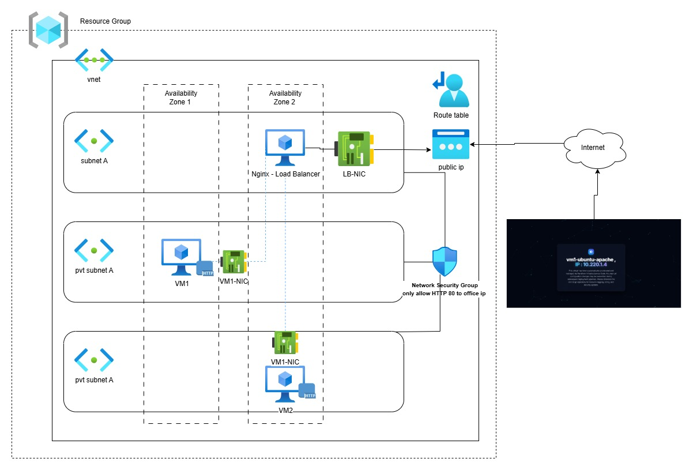

# Terraform Azure High-Availability Web Tier

This project provisions a small, redundant web application environment in
Microsoft Azure with Terraform. Two Ubuntu 22.04 virtual machines run Apache
in separate subnets/availability zones, while a third Ubuntu virtual machine
running NGINX provides a public reverse proxy and load-balances requests
between the Apache backends.

## Architecture



The deployment creates:

- One Azure resource group.
- One virtual network with two subnets:
  - `subnet-az1` (`10.0.1.0/24`) for the first Apache VM.
  - `subnet-az2` (`10.0.2.0/24`) for the second Apache VM.
- A route table associated with both subnets.
- One network security group associated with both subnets.
- Two Ubuntu 22.04 Gen2 VMs:
  - `vm1-ubuntu-apache` in availability zone 1.
  - `vm2-ubuntu-apache` in availability zone 2.
- One Ubuntu 22.04 Gen2 VM running NGINX as the public reverse proxy.
- A static Standard public IP for the NGINX VM.
- Cloud-init configuration that installs Apache on the backend VMs and NGINX
  on the proxy VM.

The NGINX VM proxies HTTP traffic to both backend private IP addresses. The
backend VMs do not receive public IP addresses.

## Prerequisites

- An Azure subscription with permission to create resource groups, networking,
  public IPs, and virtual machines.
- [Terraform](https://developer.hashicorp.com/terraform/install) 1.x.
- [Azure CLI](https://learn.microsoft.com/cli/azure/install-azure-cli).
- A region that supports the selected VM sizes and availability zones.

Authenticate before running Terraform:

```powershell
az login
az account set --subscription "<subscription-id-or-name>"
```

## Configuration

The default values are defined in [`variables.tf`](./variables.tf). The most
important values to review before deployment are:

| Variable | Default | Description |
| --- | --- | --- |
| `default_location` | `East US` | Azure region for all resources |
| `vnet_name` | `vpc-demo` | Virtual network name |
| `vnet_cidr` | `10.0.0.0/16` | Virtual network address range |
| `subnet_1_cidr` | `10.0.1.0/24` | First backend subnet |
| `subnet_2_cidr` | `10.0.2.0/24` | Second backend subnet |
| `office_IP_CIDR` | `1.2.3.4/32` | Source CIDR allowed to SSH and HTTP |
| `vm_size` | `Standard_D2als_v6` | Backend VM size |
| `lb_name` | `nginx-lb` | NGINX VM and public IP name |
| `lb_vm_size` | `Standard_D2als_v6` | NGINX VM size |

Create a local `terraform.tfvars` file to override values. For example:

```hcl
default_location = "East US 2"
office_IP_CIDR   = "203.0.113.10/32"
vm_size          = "Standard_D2als_v6"
lb_vm_size       = "Standard_D2als_v6"
```

Do not commit real passwords, private keys, or sensitive `terraform.tfvars`
files to Git.

## Deploy

Run these commands from the repository root:

```powershell
terraform init
terraform fmt -recursive
terraform validate
terraform plan -out tfplan
terraform apply tfplan
```

After the deployment completes, retrieve the public URL:

```powershell
terraform output -raw nginx_http_link
```

Open the resulting URL in a browser. Because the network security group
restricts HTTP and SSH to `office_IP_CIDR`, the client IP making the request
must be included in that CIDR.

The generated VM password can be displayed with:

```powershell
terraform output -raw vm_password
```

Treat this value as a secret. It is also stored in Terraform state because it
is used to configure the virtual machines.

## Security considerations

- Replace the example `office_IP_CIDR` value before deployment.
- The current configuration enables SSH password authentication for the
  `azureuser` account. For production use, prefer SSH keys and disable password
  authentication.
- Store Terraform state in a secured remote backend rather than sharing the
  local `terraform.tfstate` file.
- Restrict access to the state backend because the state contains the generated
  VM password and other infrastructure details.
- The NSG currently permits TCP ports 22 and 80 only from `office_IP_CIDR`.
  Review these rules before exposing the service to a wider audience.

## Destroy the environment

To remove all resources managed by this project:

```powershell
terraform destroy
```

Review the destroy plan carefully before confirming. Terraform state files are
not removed automatically and should be handled according to your state
retention policy.

## Repository layout

```text
.
├── main.tf                 # Resource group, NSG, passwords, and modules
├── provider.tf             # Terraform and provider requirements
├── variables.tf            # Root module configuration
├── outputs.tf              # Resource group, password, and NGINX URL outputs
└── modules/
    ├── NGINX-LB/           # Public NGINX reverse-proxy VM
    ├── VM/                 # Apache backend VM and cloud-init configuration
    └── VNET/               # VNet, subnets, route table, and outputs
```

## License

No license has been specified for this project.
